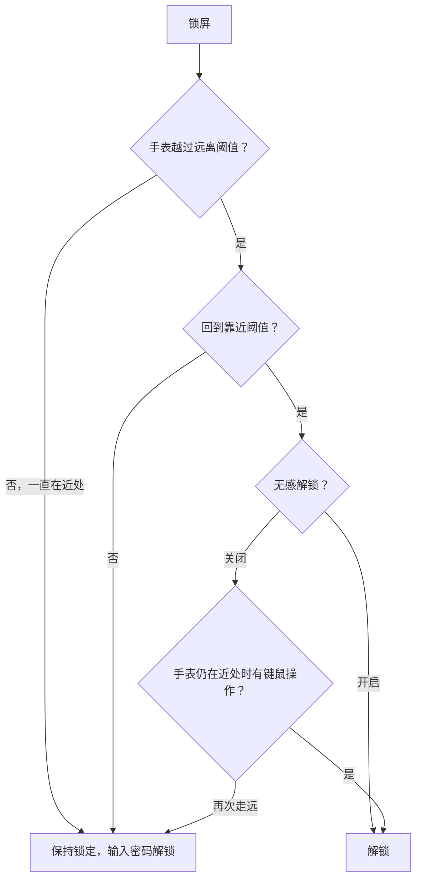

# Watch Unlock Windows

用 Apple Watch 解锁 Windows：锁屏后戴着手表走开，再走回来，电脑自动解锁。

文档站：<https://whyy1.github.io/watch-unlock-windows/>。打不开的话，直接看下面的说明，内容是一样的。

## 设计初衷

初衷就是想在 Windows 上也有 Mac 那样用 Apple Watch 无感解锁的体验，所以找到了原项目继续开发。它的安全性比不上 Apple 官方的自动解锁，只建议在可信的环境下使用。

## 安全与局限

### 局限

- **读不到手表是否戴着、是否解锁。** 实测四种状态下，手表的蓝牙广播内容完全相同。所以手表没戴，或者被别人拿着走近，同样可能触发解锁。
- **防不了广播重放和中继。** 判断只依据手表身份（IRK）和信号强度（RSSI），安全性不如 Apple 官方的 Auto Unlock。
- **RSSI 不等于距离。** 墙体、人体遮挡和手表朝向都会影响信号，偶尔会误判离开或返回。
- **关闭无感解锁，也不能确认是本人在操作。** 手表在近处时，别人动一下键鼠同样会解锁。
- 不支持远程桌面会话；安装包没有代码签名。

**已实测**（Windows 11 Pro + Apple Watch）：一键绑定，走远返回解锁（约 0.17 秒），无感解锁关闭时等待键鼠操作，原地锁屏不解锁。
**未实测**：同时绑定两块手表，休眠或蓝牙故障后的恢复，切换用户。

### 密钥与安全

账户密码、每块手表的 IRK、Bark 密钥分别用 Windows DPAPI 按当前账户加密，保存在 `%LOCALAPPDATA%\WatchUnlockWindows\`，目录只有你和 SYSTEM 能访问。其他账户读不到这些文件，硬盘被拆走后，没有你的账户密码也解不开。

密码必须能还原，因为登录时要把真实密码交给 Windows 校验。后台只在以下条件都满足时才交出密码：
- 请求来自同一会话里的系统登录界面（SYSTEM `LogonUI`）；
- 后台自身运行在只有管理员可写的 `Program Files` 目录。

绑定手表时，程序以管理员权限一次性读取 Windows 保存的这块手表的 IRK，并用实时广播验证；IRK 不会出现在命令行、日志或界面里。

这套保护能防住其他账户和离线读取，**防不了已经以你的身份运行的恶意程序**。

## 使用必看！！！

- **上面已经说明了安全和局限性。** 如果有顾虑或者不满意，可以直接关掉本页，不必安装。
- **为什么走远了没有锁屏？** 本程序只负责解锁，不负责锁屏。想走开后自动锁屏，请按[自动锁屏（Windows 动态锁）](#自动锁屏windows-动态锁)打开 Windows 自带的动态锁，它可以和本程序一起用。
- **其他蓝牙设备能不能用？** 手机等能直接在 Windows 蓝牙设置里配对的设备，配对后可以在“Windows 已配对设备”里直接绑定，不需要「开始配对」，iPhone 已验证可以绑定。其他设备尚未验证，请自行测试。使用前建议再读一遍[安全与局限](#安全与局限)。

## 使用

1. 从 [Releases](https://github.com/whyy1/watch-unlock-windows/releases) 下载 `WatchUnlock_x.y.z_x64-setup.exe` 并运行（如果弹出 Windows 管理员确认，点「是」），按向导完成安装。之后从开始菜单打开 **Watch Unlock**。卸载时，在“设置 → 应用”里找到它即可。
2. 打开「设备」页，展开「添加手表」，点「开始配对」（不点的话手表搜不到电脑）。然后在 120 秒内，在**手表**（不是 iPhone）的“设置 → 蓝牙”里，等这台电脑出现后点它，再在电脑右下角弹出的 Windows 配对通知里点「允许」。已经在 Windows 蓝牙设置里配对过的设备，跳过这一步，直接在“Windows 已配对设备”里点「绑定此设备」。
3. 配对成功后，程序会自动开始绑定，并弹出“正在绑定”的窗口。**抬腕让手表亮屏**，放在电脑旁边，最多等 30 秒；手表息屏时广播少，容易超时。绑定要读取 Windows 保存的手表密钥，需要管理员权限：如果弹出 Windows 管理员确认，点「是」（UAC 设为不提示的电脑上不会弹出）。之后调整距离、开关无感解锁、保存密码都不再需要管理员权限。如果没有自动开始，在“Windows 已配对设备”里点「绑定此设备」。配对失败时见下面的[配对排错](#配对排错)。
4. 在概览页填写 Windows 账户密码。注意要填账户密码，不是 PIN。
5. 锁屏，走远，再走回来，电脑就会解锁。

距离阈值可以在「设备」页的手表卡片里点「配置」调整。RSSI 受遮挡影响很大，建议在自己的环境里试几次再定。

笔记本合上盖子、接外接显示器使用的，请在概览页打开「合盖时继续检测手表」。这个开关默认关闭：合盖后程序停止检测手表，开盖后才恢复。

程序启动时会检查新版本，发现后先显示更新内容，由你确认再下载安装；设备、密码和设置都会保留。点左下角的版本号可以查看[更新记录](CHANGELOG.md)，也可以手动检查更新。

## 自动锁屏（Windows 动态锁）

本程序只负责解锁，不负责锁屏。想走开后自动锁屏，请打开 Windows 自带的动态锁：

1. 把手机和电脑做蓝牙配对：设置 → 蓝牙和其他设备 → 添加设备 → 蓝牙，选中手机，两边确认配对码。Apple Watch 不能用来触发动态锁，它平时不和电脑保持连接。
2. 打开 设置 → 账户 → 登录选项 → 动态锁，勾选「允许 Windows 在你离开时自动锁定设备」，下方会显示配对好的手机。
3. 带着手机离开。手机离开蓝牙范围后，Windows 大约等 30 秒到 1 分钟才锁屏；这期间有人动键盘鼠标，就不会锁。

回来时本程序照常解锁。

- **走开了却没锁屏：** 动态锁靠手机和电脑的蓝牙连接判断你是否离开。iPhone 和 Windows 的蓝牙连接不太稳定，可能锁得晚或不锁，这是 Windows 自身的行为，本程序改变不了。
- **锁屏要等一会儿：** 正常，动态锁本来就会等一段时间。

## 后台程序

解锁靠后台程序完成，界面只用来设置。后台没在运行的话，电脑不会解锁。

1. 从开始菜单正常打开 **Watch Unlock**，不需要「以管理员身份运行」。
2. 在概览页点「启动后台」。
3. 后台启动后就可以关掉应用窗口，后台会继续运行。打开任务管理器，在「进程」页搜索 `watch`，能看到 `watchd.exe` 和 `watchd-supervisor.exe` 两个进程，就说明后台在运行。

如果正常打开后后台一直起不来，再在开始菜单里右键 **Watch Unlock** →「以管理员身份运行」，然后点「启动后台」。弹出 Windows 管理员确认时，用**你自己的账户**确认；换成另一个管理员账户的话，程序会以那个账户运行，读不到你保存的设备和密码。

开机自启（概览页的开关，默认开启）会在每次登录 Windows 时自动启动后台。登录后如果在任务管理器里找不到上面两个进程，说明后台没有自启成功，打开应用手动启动后台即可。重启后的第一次登录仍要手动输入密码，因为那时后台还没运行。要停止后台，打开应用在概览页点「停止后台」。

## 已知问题

- **部分手表息屏时，实时信号会中断。** 实测 S12（watchOS 27.0.1）息屏时信号不中断；有用户反馈 S9、S10 息屏时检测不到信号，大概率是设备本身的原因，请酌情使用。
- **同一块手表，换一台电脑可能搜不到。** 可能受这台电脑的蓝牙版本或硬件限制，见下面的[配对排错](#配对排错)。
- **保存账户密码失败，大多是 Windows 密码填错了。** 请填写本机登录账户的密码，不支持 PIN，注意区分大小写。如忘记密码，可在锁屏界面选择密码登录，输入一次错误密码后点击「重置密码」完成重置，新密码即为应填写的密码。

## 配对排错

Apple Watch 本身不能和 Windows 配对。程序的做法是让电脑临时充当一个蓝牙配件来广播，手表才能在“设置 → 蓝牙”里看到它。所以能否配对，也取决于电脑的蓝牙硬件。配对失败时，界面会显示下面的原因之一：

| 提示 | 处理办法 |
| --- | --- |
| 没有找到蓝牙适配器 | 确认电脑有蓝牙，驱动已安装，没有在设备管理器里被禁用。 |
| 蓝牙已关闭 | 点「打开 Windows 蓝牙设置」，打开蓝牙后重试。 |
| 不支持低功耗蓝牙 | 适配器太旧，需要换一个支持蓝牙 4.0 以上的适配器。 |
| 不支持外设模式 | 不少笔记本自带网卡和 USB 蓝牙适配器不支持充当外设，软件无法绕过，需要换一个支持外设模式（Peripheral role）的 USB 蓝牙适配器。 |
| 配对服务启动失败、广播被中断 | 关掉其他正在使用蓝牙的程序，重新开关一次蓝牙后重试。 |

其他常见情况：
- **手表上看不到这台电脑**：配对窗口只开 120 秒，过期后重新打开；让手表靠近电脑。
- **配对时 Windows 弹出「为设备配对 · 未知设备 · 连接失败」**：这是 Windows 自己的弹窗，通常是 Windows 蓝牙卡在了上一次没完成的配对上。点「关闭」，在手表的蓝牙列表里忽略这台电脑；Windows 蓝牙设置里如果有残留的旧配对，也一并删除。然后**重启电脑**，再重新点「开始配对」。只关闭再打开蓝牙往往不够。
- **手表显示已连接，但程序没有反应**：大多是漏点了 Windows 右下角的配对通知。开着勿扰或专注模式时通知不会弹出，按 Win + N 打开通知中心查找；过期的话重新打开配对窗口再试一次。
- **平时手表显示“未连接”**：正常。配对只为让 Windows 记下手表的身份密钥，之后程序靠手表自身的蓝牙广播判断距离，不需要保持连接。
- **配对完成后，Windows 偶尔提示手表“连接失败”**：电脑只在配对窗口打开时临时充当蓝牙配件，之后 Windows 或手表再尝试连接时可能失败。解锁不依赖这个连接，所以只要走远再回来仍能正常解锁，就可以忽略这条提示。如果同时出现无法解锁，请在「解锁记录」页点「复制诊断信息」，粘贴发给开发者。
- **以前配对过**：如果手表已经出现在「设备」页「添加手表」里的“Windows 已配对设备”中，直接点「绑定此设备」，不用重新配对。绑定一直失败时，再在 Windows 蓝牙设置里删除这块手表、在手表的蓝牙列表里忽略这台电脑，然后重新配对。

## 反馈问题

遇到问题时，打开「解锁记录」页，点「复制诊断信息」，把内容直接粘贴到聊天里发给开发者即可。需要完整内容时，点「导出诊断信息」。程序会在“下载”文件夹生成一个 `WatchUnlock-诊断-日期-时间.txt`，并在文件资源管理器中选中它，把这个文件发给开发者即可。

文件包含：应用和 Windows 版本、安装与自启状态、蓝牙适配器能力、设备设置、最近 500 条事件和后台日志。**不含**账户密码、手表密钥（IRK）、Bark 密钥、电脑名和设备名：密钥只记录是否已保存，设备按顺序记为「设备 1」「设备 2」。只保留通知服务器的域名。

## 解锁规则

- **只有“先离开、再回来”才会解锁。** 锁屏后手表信号低于远离阈值，就记为离开；回到靠近阈值时触发解锁。锁屏后一直待在电脑旁，不会自动解锁，需要照常输入密码。用 Windows 动态锁锁屏时，手表在锁屏前就越过了远离阈值，也算离开，回来就能解锁。
- **无感解锁**（按设备设置，默认开启）：
  - 开启：靠近后立即解锁。
  - 关闭：回来后要动一下键盘或鼠标才解锁。手表一直在近处时，会一直等你操作；再次走远，这次返回就作废。
- **通知**（可选）：解锁后通过 [Bark](https://apps.apple.com/app/id1403753865) 推送一条提醒。通知不参与解锁判断。也可以用自建的 Bark 服务器。



## 开发

```text
apps/desktop/            Tauri 界面
backend/crates/domain    距离策略（纯逻辑）
backend/crates/watchd    后台：蓝牙扫描、会话监测、秘密存储、通知
backend/crates/provider  Windows 登录组件（Credential Provider）
scripts/                 构建、隐私检查、第三方许可清单
```

```powershell
./scripts/Build.ps1 -Action test       # 后端测试
./scripts/Build.ps1 -Action package    # 全部测试，生成安装程序 dist/WatchUnlock_x.y.z_x64-setup.exe
```

环境要求、GNU 工具链参数和开发调试方式见 [docs/development.md](docs/development.md)。如果要接入其他手表，实现 `backend/crates/watchd/src/adapters.rs` 里的 `DeviceAdapter` 即可，距离策略、凭据和登录组件都可以复用。

## 许可

本项目基于 [xiaoka520/watch-unlock-windows](https://github.com/xiaoka520/watch-unlock-windows)（修订 `157f8eb`）修改，按 [GNU AGPL v3](LICENSE) 发布，来源与修改说明见 [NOTICE](NOTICE)。你可以使用、修改和商业分发本项目；分发修改版本时，需要同时提供对应源码，并保留 `LICENSE`、`NOTICE` 和 `licenses/`。用 `Build.ps1 -Action package` 打出的安装包已经包含这些内容。

Apple Watch、iPhone、Windows 等名称只用来说明兼容性，本项目与 Apple 无关。

## 支持一下

如果这个项目帮你省掉了每天输密码的麻烦，欢迎在 GitHub 上点一个 Star ⭐，这是对项目继续更新最直接的鼓励。遇到问题或有想法，也欢迎提 Issue。
